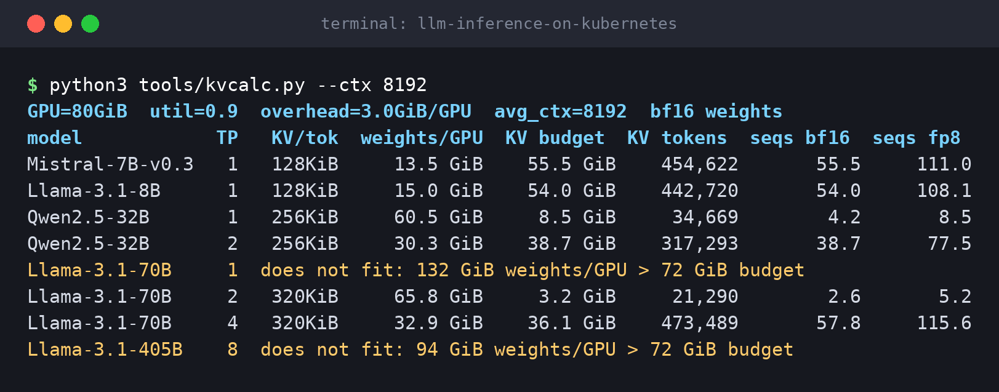
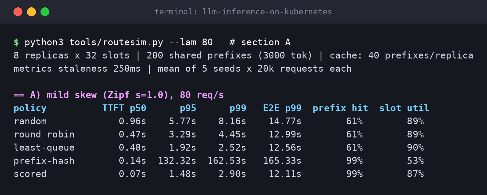
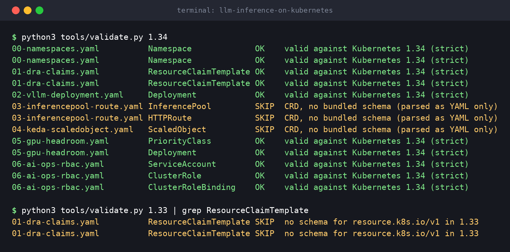

# LLM inference on Kubernetes: configs, calculators and a routing simulator

[](https://github.com/Bilalkhanten/llm-inference-on-kubernetes/actions/workflows/ci.yml)

Companion code for the article **"I Stopped Lying to the Kubernetes Scheduler About My GPUs"**
(DRA, KV-cache math, inference-aware routing and autoscaling that respects a long cold start).

> **Status, honestly:** the manifests are schema-validated offline against Kubernetes 1.34 (built-in kinds only)
> and YAML-linted. They have **not** been applied to a live GPU cluster as part of building this repo.
> Treat them as a well-checked starting point, not a tested deployment. The calculators and the simulator are
> models with stated assumptions, not benchmarks.



## Layout

| Path | What it is |
|---|---|
| `tools/kvcalc.py` | KV-cache capacity calculator: tokens and concurrent sequences per GPU for a model / TP / dtype |
| `tools/captool.py` | Little's-law replica sizing plus the headroom you need for a given cold-start time |
| `tools/routesim.py` | Toy discrete-event simulator comparing routing policies (random, round-robin, least-queue, prefix-hash, scored) |
| `tools/validate.py` | Offline schema validation of `manifests/` against Kubernetes OpenAPI schemas, no cluster needed |
| `tools/render.py`, `tools/make_screenshots.sh` | Render captured tool output into the terminal-style PNGs in `docs/img/ss*.png` |
| `tools/make_figures.py` | Draws the charts and architecture diagram (`docs/img/fig*.png`) from the tools' own numbers |
| `tools/make_cover.py` | Draws the article cover and the GitHub social preview from `kvcalc` numbers (`docs/img/cover-*.png`) |
| `manifests/` | DRA claims, vLLM Deployment, InferencePool + HTTPRoute, KEDA ScaledObject, GPU headroom pods, read-only agent RBAC |
| `tests/` | pytest suite (runs without a cluster or a GPU) |
| `docs/article.md` | The article that goes with this repo (images in `docs/img/`) |

## Quickstart

```bash
python3 -m venv .venv && source .venv/bin/activate
make install        # pyyaml, kubernetes-validate, yamllint, pillow, matplotlib, pytest
make all            # kvcalc, capacity, routesim, validate
make test           # 14 tests
make lint           # yamllint on manifests/
make screenshots    # regenerate docs/img/ss*.png from real tool output
make figures        # regenerate docs/img/fig*.png (charts + architecture diagram)
```

Everything is plain Python 3 with no GPU and no cluster required.

## The tools

### `kvcalc.py`: how many sequences fit?

```bash
python3 tools/kvcalc.py --gpu-gib 80 --util 0.90 --overhead-gib 3 --ctx 8192
```

Per-token KV cost is `2 x layers x kv_heads x head_dim x dtype_bytes`, divided by the tensor-parallel degree.
`--overhead-gib` (activations, CUDA graphs, NCCL buffers) is an **assumption**. Check it against the KV-cache size
your engine prints at startup and adjust.

### `captool.py`: replicas and headroom

```bash
python3 tools/captool.py --qps 60 --e2e 6 --seqs-per-replica 54 --target-util 0.7 --ramp-qps-per-min 20
```

In-flight sequences = arrival rate x time in system (Little's law). Headroom is the traffic that arrives *while a new
replica is still booting*, so it scales with your cold-start time.

### `routesim.py`: does smart routing help?

```bash
python3 tools/routesim.py --lam 80              # 80 req/s across 8 replicas
python3 tools/routesim.py --lam 80 --stale 2.0  # router sees 2-second-old queue depths
```



It models slots, a FIFO queue, a per-replica LRU prefix cache and stale metrics. It does **not** model prefill/decode
interference, and `scored` is an EPP-*style* function, not the real endpoint-picker algorithm. All constants
(`t_pre`, `t_dec0`, `t_dec_k`, cache size, ...) are assumptions at the top of `Sim.__init__`. Use it to see *shapes*
(hard prefix affinity melts down under a hot prefix, stale metrics make least-queue herd) and then measure your own system.

### `validate.py`: schema-check the manifests

```bash
python3 tools/validate.py 1.34
```

Built-in kinds (Namespace, Deployment, PriorityClass, RBAC, and `resource.k8s.io/v1` ResourceClaimTemplate) are validated
strictly. CRDs (InferencePool, HTTPRoute, KEDA ScaledObject) have no bundled schema and are reported as `SKIP`. Exit code
is 1 on any `FAIL`.



## Manifests

| File | Contents |
|---|---|
| `00-namespaces.yaml` | `inference`, `ops-agents` namespaces |
| `01-dra-claims.yaml` | ResourceClaimTemplates: one big-memory GPU (CEL selector), and a 2-GPU TP=2 claim with a `matchAttribute` constraint |
| `02-vllm-deployment.yaml` | vLLM Deployment using a DRA claim, cold-start-sized probes, `preStop` sleep, `/dev/shm` |
| `03-inferencepool-route.yaml` | GAIE `InferencePool` (with `endpointPickerRef`) and an `HTTPRoute` pointing at it |
| `04-keda-scaledobject.yaml` | KEDA ScaledObject on queue depth and KV-cache usage, with asymmetric HPA behaviour |
| `05-gpu-headroom.yaml` | Low-priority placeholder pods that hold GPU capacity (opt-in) |
| `06-ai-ops-rbac.yaml` | Read-only identity for an AI ops agent (opt-in) |
| `kustomization.yaml` | Applies `00` to `04`; `05` and `06` are commented out on purpose |

### Prerequisites before applying

- Kubernetes **1.34+** (DRA GA, `resource.k8s.io/v1`) and the **NVIDIA DRA driver** installed
- Gateway API CRDs and a gateway implementation that supports GAIE `InferencePool` / the endpoint picker; install the
  pool + EPP from the upstream Helm chart (read `helm show values` for your pinned version first)
- KEDA and a Prometheus that scrapes the vLLM pods
- In namespace `inference`: Secret `hf-token` (key `token`) and a PVC `model-cache`
- A real image **digest** for vLLM (the manifest ships an all-zero placeholder)

### Things you must check on *your* cluster

- **DRA constraint attribute.** `01-dra-claims.yaml` uses `example.com/interconnect-domain` as a placeholder. Read an actual
  `ResourceSlice` (`kubectl get resourceslice -o yaml`) and use an attribute your driver publishes.
- **vLLM metric names change between versions.** The ScaledObject uses `vllm:gpu_cache_usage_perc`; newer releases may expose
  `vllm:kv_cache_usage_perc`. Check `/metrics`. A wrong name returns an empty result and the autoscaler **fails quietly**.
- **GAIE chart values** move between releases. Pin a version.
- **Placeholder-pod preemption** of DRA-claimed pods should be validated on your Kubernetes version and driver before you rely on it.

```bash
kubectl apply -k manifests/
```

## CI

`.github/workflows/ci.yml` runs on every push and pull request as a dependency graph (arrows are `needs:`):

```
lint ──┬──▶ validate (Kubernetes 1.34 - 1.37) ──┐        ┌──▶ screenshots
       ├──▶ kustomize ──────────────────────────┼──▶ tools┤
       └──▶ test (Python 3.10, 3.12, 3.13) ─────┘        └──▶ figures
```

| Job | What it checks |
|---|---|
| `lint` | `make lint`: yamllint on `manifests/` |
| `validate` | `make validate` once per Kubernetes version (built-in kinds strictly, CRDs skipped as described above) |
| `kustomize` | `kubectl kustomize manifests/` renders offline, and the opt-in files (`05`, `06`) must stay out of the default render |
| `test` | `make test` on three Python versions |
| `tools` | `make all`: every tool runs once |
| `screenshots` | `make screenshots` re-renders `docs/img/ss*.png` from real tool output and uploads it as an artifact (not compared byte for byte, since Pillow and font versions change the pixels) |
| `figures` | `make figures` and `make covers` redraw the charts, architecture diagram and article covers from the tools' own numbers and upload them |

Like the rest of the repo, CI never touches a cluster: the manifests are checked and rendered, not applied. The workflow also has a
"Run workflow" button (`workflow_dispatch`).

## License

MIT, see [LICENSE](LICENSE).
