# I Stopped Lying to the Kubernetes Scheduler About My GPUs 🎮⚡

*DRA, KV-cache math, inference-aware routing and autoscaling that respects a 15-minute cold start. Real numbers, real configs, zero hand-waving.*

---

Okay, confession time 🙈

The first time I put an LLM behind a Kubernetes `Service`, it just *worked*. Pods green, `curl` returned tokens, I felt like a genius.

That's the trap. Kubernetes happily lets you run a model while every primitive underneath is quietly making a wrong assumption:

1. 🔢 **"A GPU is an integer."** `nvidia.com/gpu: 1` says nothing about memory, topology or partitioning.
2. 🎲 **"Backends are interchangeable."** Two identical vLLM pods can differ 10x in how much work they can accept *right now*, depending on KV-cache contents and queue depth.
3. 📉 **"Load shows up in CPU."** A saturated GPU server can sit at a boring CPU% while requests pile up in a queue.
4. ⏱️ **"Pods start fast."** A cold replica means: schedule onto a GPU node → pull a multi-GB image → load weights → warm kernels. Minutes, not seconds.
5. 🧠 **"Capacity is requests/sec."** Capacity is **KV-cache tokens**. Full stop.

This post is how I fix each of those, layer by layer: **capacity math → device allocation → the serving pod → routing → autoscaling → (bonus) letting an AI agent near your cluster without losing sleep.**

Here's the map I'll keep coming back to. Blue is the request path, green is how GPUs get bound to pods, orange is the scaling loop:

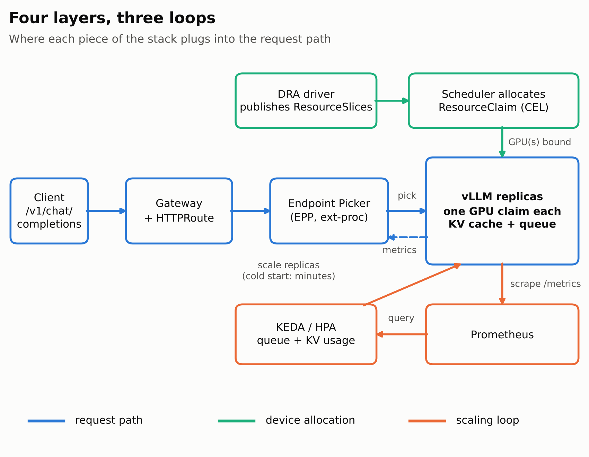

*Figure 1. Three loops around one set of vLLM replicas. Each section below zooms into one of them.*

It's written for people who already run prod clusters. I'll skip "what is a Pod" and spend words where the defaults hurt. 🩹

**Stack:** Kubernetes ≥ 1.34 (DRA is GA there), NVIDIA's DRA driver, vLLM, Gateway API Inference Extension (GA since Sept 2025), KEDA, Prometheus.

**A note on the screenshots** 📸: every terminal screenshot below is real output from tools I wrote for this post (a KV calculator, a capacity planner, a routing simulator and an offline schema validator), all in the [repo](https://github.com/Bilalkhanten/llm-inference-on-kubernetes). I don't paste `kubectl` output I didn't capture, and the manifests are schema-validated offline rather than load-tested on a live cluster, so treat them as a carefully checked starting point.

---

## 🧮 Step 0: do the math *before* you write YAML

Everything downstream (probe budgets, replica counts, autoscaling thresholds) falls out of one question: **how many tokens of KV cache fit on a GPU after weights?**

Per-token KV cost for a transformer with grouped-query attention:

```
KV bytes/token = 2 (K and V) × layers × kv_heads × head_dim × dtype_bytes
```

For Llama-3.1-8B (32 layers, 8 KV heads, head_dim 128, bf16) that's `2×32×8×128×2 = 128 KiB/token`. With tensor parallelism the KV heads get sharded across ranks, so the per-GPU cost divides by TP.

I wrapped it in a small calculator. 80 GiB cards, `--gpu-memory-utilization 0.90`, an assumed 3 GiB/GPU for activations + CUDA graphs + NCCL buffers, 8k average live context:

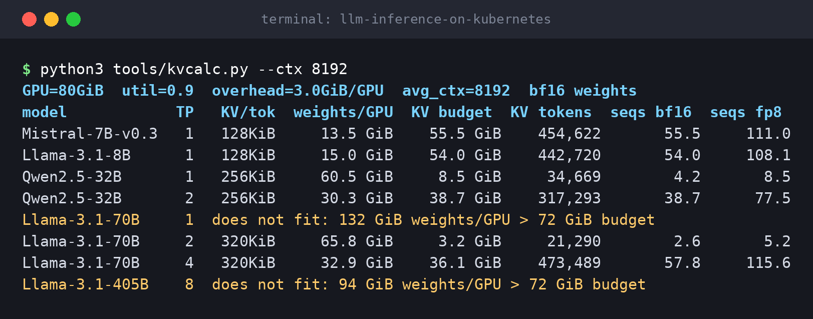

Things that jumped out at me:

- 🟢 **8B-class on one 80 GiB GPU:** ~54 concurrent 8k-token sequences. Comfortable.
- 🟡 **32B at TP=1 technically fits** (60 GiB of weights) but leaves ~8.5 GiB for KV, so **~4 sequences**. It "works" and is useless. TP=2 gives **~39**. That's a ~9x jump from doubling GPUs, because you're freeing weight memory *per GPU*, not just adding compute.
- 🔴 **70B at TP=2:** weights eat 65.8 GiB per GPU, leaving **3.2 GiB** → ~21k KV tokens → **2.6 concurrent 8k sequences**. Your shiny 2-GPU 70B deployment serves roughly *two and a half users at a time*. TP=4 gets you **~58**.
- 💾 **fp8 KV cache doubles the sequence counts** (compare the last two columns). It's one of the cheapest capacity levers you have, if your quality eval tolerates it.
- 🚫 **405B at TP=8 on 80 GiB cards doesn't fit in bf16** (94 GiB of weights per GPU). The calculator says so instead of hallucinating a number.

Same numbers as a picture, with the fp8 option next to bf16:

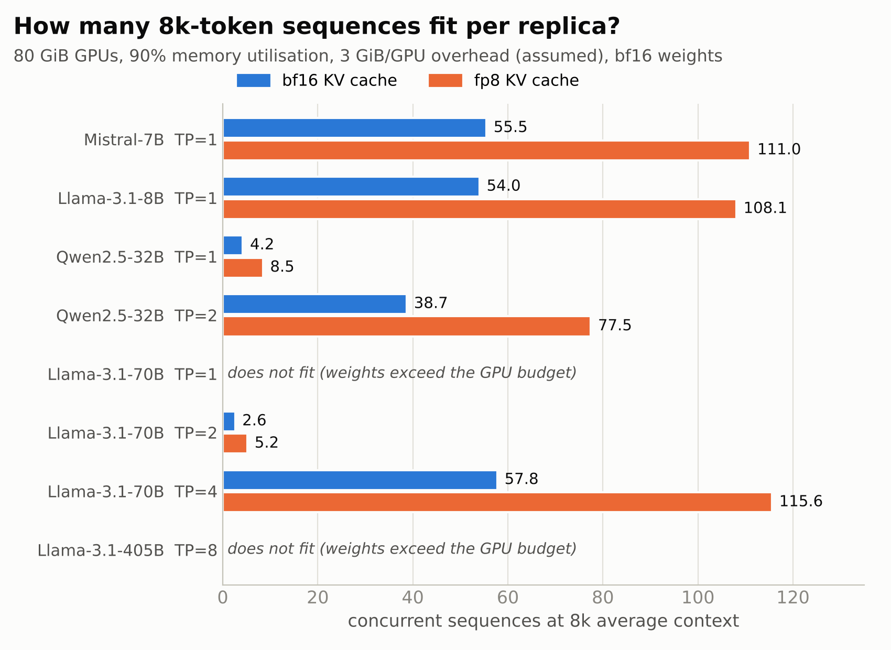

*Figure 2. Concurrent 8k-token sequences per replica. Generated from the calculator in the repo (`make figures`).*

Caveat, because I like being honest: the 3 GiB overhead is an assumption and real engines differ. Treat this as a sizing model, then **verify against what the engine reports at boot** (more on that in Layer 2).

The takeaway I internalised: **your concurrency ceiling is `KV token budget ÷ average live context`**, so `--max-model-len` set to what the product *needs* rather than what the model *supports* is basically a free capacity knob.

---

## 🎛️ Layer 1: Device allocation with DRA (goodbye, node labels)

The classic pattern is `nvidia.com/gpu: 1` plus a `nodeSelector` on `nvidia.com/gpu.product`. Fine until your fleet is mixed. Then every Deployment becomes a statement about your hardware inventory, and the scheduler can't reason about "any GPU with ≥ 70 GiB".

**Dynamic Resource Allocation** (GA in Kubernetes 1.34) fixes that the same way storage got fixed. A driver publishes `ResourceSlice`s per node, platform admins define a `DeviceClass`, and workloads ask for devices with a `ResourceClaim`, or a `ResourceClaimTemplate` for one claim per pod.

First, look at what your driver actually advertises. Never write a CEL selector blind:

```bash
kubectl get deviceclass
kubectl get resourceslices -o wide
kubectl get resourceslice <name> -o yaml | less
```

Here's the single-GPU, big-memory claim I use for 8B-class replicas, plus a two-GPU claim for a TP=2 replica:

```yaml
apiVersion: resource.k8s.io/v1
kind: ResourceClaimTemplate
metadata:
  name: llm-gpu-70g
  namespace: inference
spec:
  spec:
    devices:
      requests:
      - name: gpu
        exactly:
          deviceClassName: gpu.nvidia.com
          selectors:
          - cel:
              expression: |
                device.capacity['gpu.nvidia.com'].memory
                  .compareTo(quantity('70Gi')) >= 0
---
apiVersion: resource.k8s.io/v1
kind: ResourceClaimTemplate
metadata:
  name: llm-gpu-tp2
  namespace: inference
spec:
  spec:
    devices:
      requests:
      - name: gpus
        exactly:
          deviceClassName: gpu.nvidia.com
          allocationMode: ExactCount
          count: 2
      constraints:
      - requests: ["gpus"]
        matchAttribute: example.com/interconnect-domain   # ⚠️ placeholder: use an attribute from YOUR ResourceSlice
```

That `constraints` block is the bit I care about most for multi-GPU serving: "give me two GPUs that share this attribute" is how you stop a TP=2 pair from straddling a slow link. The attribute name is **driver-specific**, so I deliberately left a placeholder. Go read your slices.

### 🧪 Validate the manifests without a cluster

DRA's API shape moved across beta versions (the device fields now live under `exactly`). Instead of trusting a blog post (including this one 😅), I validate against the real OpenAPI schemas, offline:

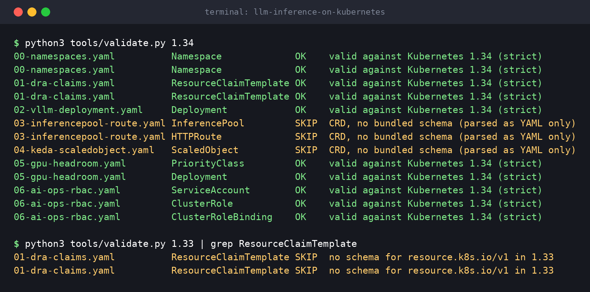

Two honest readings of that screenshot:

- ✅ Everything built-in validates **strictly** against 1.34, including the `exactly` request shape and the `preStop` sleep action.
- 🟡 The CRDs (InferencePool, HTTPRoute, KEDA's ScaledObject) get **SKIP**: the validator has no bundled schema for them, so those were only checked as YAML. And the second command shows the validator has no `resource.k8s.io/v1` schema for **1.33**: that's the version gate you hit if you try this on an older control plane.

Once a pod lands, the claim is where you debug placement:

```bash
kubectl -n inference get resourceclaim
kubectl -n inference describe resourceclaim <generated-name>
```

⚠️ **Don't double-advertise GPUs.** If a node pool runs both the legacy device plugin *and* the DRA driver against the same cards, you've got two allocators with two views of reality. Pick one per node pool and make the migration an explicit, labelled cutover.

---

## 🏗️ Layer 2: The serving pod (where defaults bite)

The interesting parts of the Deployment (full file in the repo, schema-validated above):

```yaml
spec:
  terminationGracePeriodSeconds: 180
  resourceClaims:
  - name: gpu
    resourceClaimTemplateName: llm-gpu-70g
  containers:
  - name: vllm
    args:
    - --model=meta-llama/Llama-3.1-8B-Instruct
    - --served-model-name=llama-3.1-8b
    - --max-model-len=16384
    - --gpu-memory-utilization=0.90
    - --max-num-seqs=128
    - --max-num-batched-tokens=8192
    - --enable-prefix-caching
    resources:
      claims:
      - name: gpu
    startupProbe:
      httpGet: { path: /health, port: http }
      periodSeconds: 10
      failureThreshold: 120        # 20 min budget: pull + weights + warmup
    lifecycle:
      preStop:
        sleep:
          seconds: 30              # let the endpoint picker drop us first
    volumeMounts:
    - { name: dshm, mountPath: /dev/shm }
  volumes:
  - name: dshm
    emptyDir: { medium: Memory, sizeLimit: 16Gi }
```

The lines that earned their keep:

- 🎚️ **`--gpu-memory-utilization` is a capacity decision, not a safety margin.** It sets how much device memory the engine grabs up front; whatever's left after weights and activations becomes KV cache. It feeds directly into the table from Step 0.
- ⚖️ **`--max-num-seqs` / `--max-num-batched-tokens` shape your latency curve.** Bigger batches buy throughput and cost tail latency, because prefill (compute-bound) and decode (memory-bandwidth-bound) share the same engine step. Tune against *replayed real traffic*, not a fixed-length synthetic prompt. Recent vLLM versions use chunked prefill to soften that interference; confirm the default on your version.
- 🩺 **Size `startupProbe` for the *cold* path.** If you derive it from a warm restart on a node with a cached image, your first scale-up on a fresh node crash-loops and you blame the autoscaler for an evening. I'd rather you learn that from the arithmetic than from an outage.
- 💽 **Weights are infrastructure.** Pulling them from object storage on every cold start couples your scale-up latency to someone else's bandwidth. I mount a pre-populated read-only volume or node-local cache. Mounting an OCI artifact as a volume is attractive for this (reuses your registry and its caching), but check the feature-gate state on your version before designing around it.
- 🧯 **Shutdown ordering matters.** The `preStop` sleep gives the endpoint picker time to stop sending new requests *before* the process starts draining. Otherwise the first thing a terminating pod receives is a fresh 2,000-token generation that's about to be cut off.
- 🧠 **`/dev/shm` isn't optional** for multi-process / tensor-parallel setups; the default 64 MiB will bite you.

Now confirm what the engine *actually* allocated, and compare against the Step 0 model:

```bash
kubectl -n inference logs deploy/vllm-llama -c vllm \
  | grep -Ei "kv cache|cuda graph|max concurrency|model loading"
```

If the token count in those logs is wildly different from the calculator's, one of your assumptions (overhead, dtype, model config) is wrong. That's a finding, not a failure.

---

## 🧭 Layer 3: Routing (round-robin is a capacity bug)

A `Service` balances connections across pods it assumes are interchangeable. LLM requests aren't:

- 📏 Cost scales with prompt length *and* output length, and output length is unknown at routing time.
- ♻️ A replica holding the KV blocks for a long shared prefix (system prompt, RAG context, chat history) skips most of the prefill. Send that request elsewhere and you throw away free work.
- 🌊 Queue depth and KV utilisation differ per replica and change every few hundred ms.

**Gateway API Inference Extension (GAIE)** keeps Gateway API as the front door and adds an **Endpoint Picker (EPP)** that the gateway consults over ext-proc before forwarding. The EPP scores pods using live model-server metrics (queue length, KV utilisation, adapter locality, prefix affinity) and tells the gateway exactly which pod gets the request.

The API surface is an `InferencePool` (selects model-server pods, points at the EPP) plus a normal `HTTPRoute` whose backend is the pool:

```yaml
apiVersion: inference.networking.k8s.io/v1
kind: InferencePool
metadata:
  name: llama-pool
  namespace: inference
spec:
  targetPorts:
  - number: 8000
  selector:
    matchLabels:
      app: vllm-llama
  endpointPickerRef:
    name: llama-pool-epp
    port:
      number: 9002
---
apiVersion: gateway.networking.k8s.io/v1
kind: HTTPRoute
metadata:
  name: llama
  namespace: inference
spec:
  parentRefs:
  - name: inference-gateway
    namespace: gateway-system
  rules:
  - backendRefs:
    - group: inference.networking.k8s.io
      kind: InferencePool
      name: llama-pool
```

You normally install the pool and EPP via the upstream Helm chart. The values schema moves between releases, so read it first: `helm show values oci://registry.k8s.io/gateway-api-inference-extension/charts/inferencepool --version <pin>`. You also need a gateway implementation that supports `InferencePool` and calls the EPP; check the upstream implementations list before picking one.

### 🔬 But does smart routing actually help? I built a toy to find out

Rather than just assert "prefix-aware routing is good", I wrote a small discrete-event simulator: 8 replicas × 32 slots, 200 shared 3,000-token prefixes with Zipf popularity, a per-replica LRU prefix cache that can hold 40 prefixes, and **stale metrics** (the router sees queue depths refreshed every 250 ms, like a scraped `/metrics`).

Five policies: `random`, `round-robin`, `least-queue`, `prefix-hash` (sticky hashing on the prefix id) and `scored` (an EPP-*style* function: queue pressure minus a bonus for a cache hit).

> ⚠️ **This is a toy.** The constants (prefill/decode speeds, cache size) are mine, it ignores prefill/decode interference, and `scored` is *not* the real EPP's algorithm. It's here to show *shapes*, not to predict your numbers.

**Scenario A: mild skew, 80 req/s, ~90% slot utilisation:**

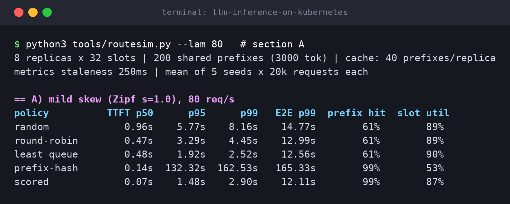

- 🏆 `scored` crushes the median: **TTFT p50 0.07 s** vs 0.47 s for round-robin and 0.96 s for random, with a **99% prefix-cache hit rate** vs ~61%. Why: 8 caches × 40 prefixes = 320 slots for a 200-prefix universe. With the right routing the *fleet's* aggregate cache holds everything; with blind routing every replica caches a random, overlapping 20%.
- 🎯 `least-queue` is the tail champion on p99 (2.52 s vs 2.90 s) because it ignores cache and just dodges congestion.
- 💥 `prefix-hash` has the best hit rate and a **p99 of 162 s**. Sticky hashing means a popular prefix pins its traffic to one replica. Keep reading.

**Scenario B: hot-prefix skew (Zipf s=1.6):**

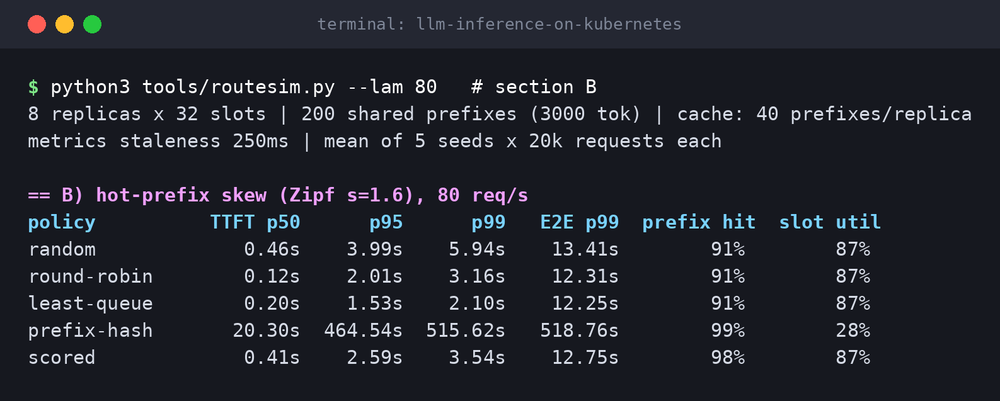

- 🔥 `prefix-hash` falls off a cliff (p95 **464 s**). One replica owns the hottest prefix and gets buried while the rest idle. (Its "28% slot util" is deflated for the same reason: the run's wall-clock is dominated by that one replica draining.)
- 🤝 Here even `random`, `round-robin` and `least-queue` already hit ~91%, because the hot prefixes end up cached on all 8 replicas. Cache-awareness has little left to win, and plain `least-queue` (p99 2.10 s) beats `scored` (3.54 s).

Both scenarios in one chart (bars capped at 10 s, off-scale values written out):

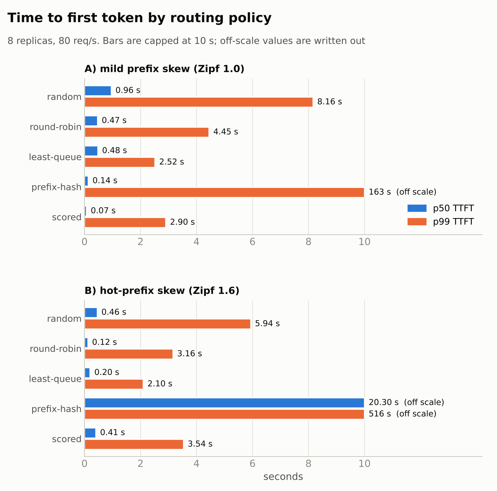

*Figure 3. Median and tail time-to-first-token by routing policy. Toy simulator, assumed constants; read the shapes, not the seconds.*

I also ran it at 95 req/s, where every policy except `prefix-hash` collapsed into 13 to 16 s median TTFT. **Routing redistributes capacity; it can't create it.**

What I took from this:

1. **Cache affinity is a *score*, never a rule.** Hard affinity is a single-replica outage waiting for a hot prefix.
2. The payoff depends on **working-set size vs. per-replica cache**. If the hot set fits everywhere, queue-aware routing is enough; if the working set only fits *across* the fleet, affinity wins big.
3. **Metric staleness is a first-class parameter.** My main runs use 250 ms-old queue depths. I reran scenario A with `--stale 2.0` (2-second-old metrics): `least-queue` went from a 0.48 s to a **5.74 s** median TTFT, *worse than blind round-robin (0.47 s)*, because every request in that window sees the same "emptiest" replica and herds onto it. `scored` degraded too (0.07 s → 1.84 s), though it kept its cache-hit advantage (91% vs 61%). Fresh metrics matter more than a clever policy.
4. The EPP is now a **hard dependency in your request path**. Run more than one replica, decide deliberately between fail-open (fall back to round-robin) and fail-closed on the ext-proc filter, and alert on EPP latency. A smart router that's down is worse than a dumb one that's up. 🫠

The staleness experiment as a chart (scenario A, 80 req/s), and the raw run behind the 2-second point:

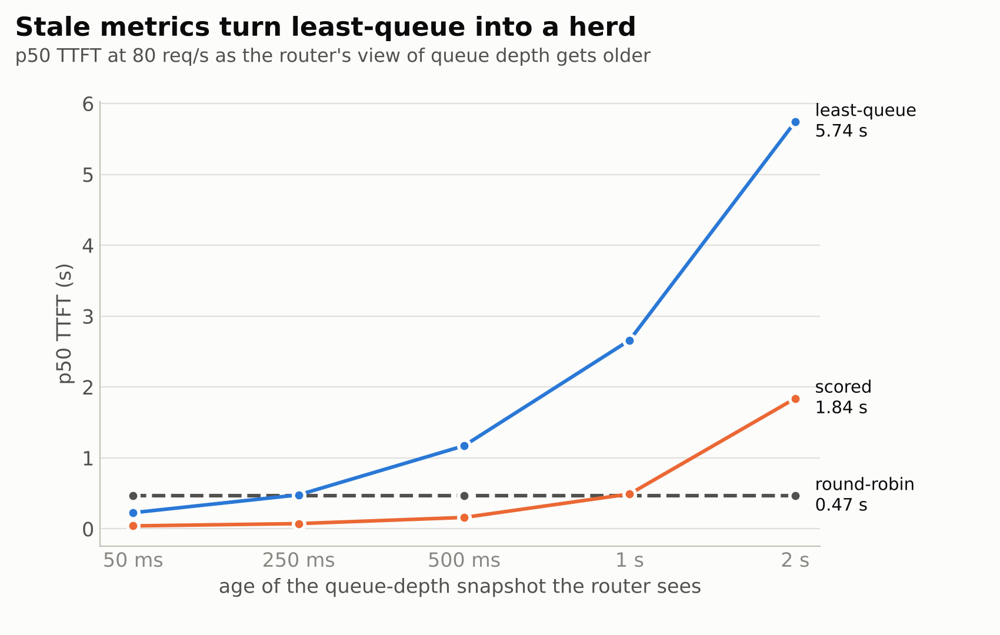

*Figure 4. Same traffic, same replicas: only the age of the queue-depth snapshot changes.*

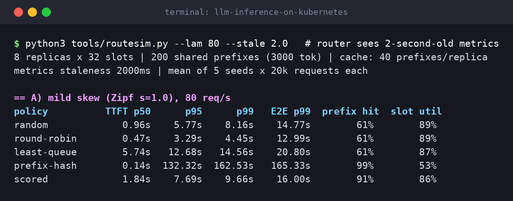

---

## 📈 Layer 4: Autoscaling (queues, not CPU, and respect the cold start)

CPU-based HPA on an inference Deployment tells you almost nothing. The signals that matter come from the engine:

- 📬 `vllm:num_requests_waiting`: work admitted but not yet scheduled. Non-zero means you're already saturated. It's a **lagging** indicator.
- 🏃 `vllm:num_requests_running`: current batch occupancy.
- 🧱 **KV cache usage**: the **leading** indicator. ⚠️ The metric name differs across vLLM versions (`vllm:gpu_cache_usage_perc` on older releases, `vllm:kv_cache_usage_perc` on newer), so check `/metrics` on yours instead of copying mine.

```bash
kubectl -n inference port-forward deploy/vllm-llama 8000:8000 &
curl -s localhost:8000/metrics | grep -E "^vllm:(num_requests|.*cache_usage)"
```

### ⏳ The uncomfortable arithmetic: Little's law vs. your cold start

In-flight requests `N = λ × W` (arrival rate × time in system). So at 60 req/s with a 6 s mean end-to-end time you're carrying **360 concurrent sequences**; at ~38 usable sequences per replica (54 KV-bound × 70% target occupancy) that's **10 replicas** in steady state.

The real question is what happens when traffic *ramps* while a new replica spends N minutes becoming useful:

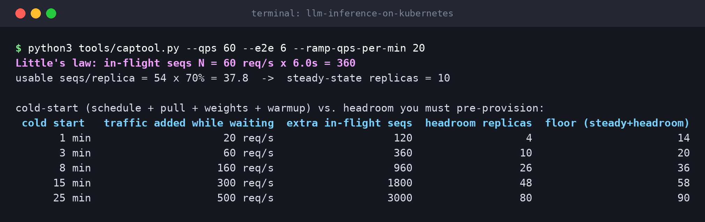

If traffic can grow 20 req/s per minute and your cold start (schedule + pull + weights + warmup) takes **15 minutes**, you need **48 replicas of pre-provisioned headroom** on top of the 10 you need today. At 25 minutes it's 80. At 1 minute it's 4.

And as a curve, so you can see how steep the price of a slow cold start is:

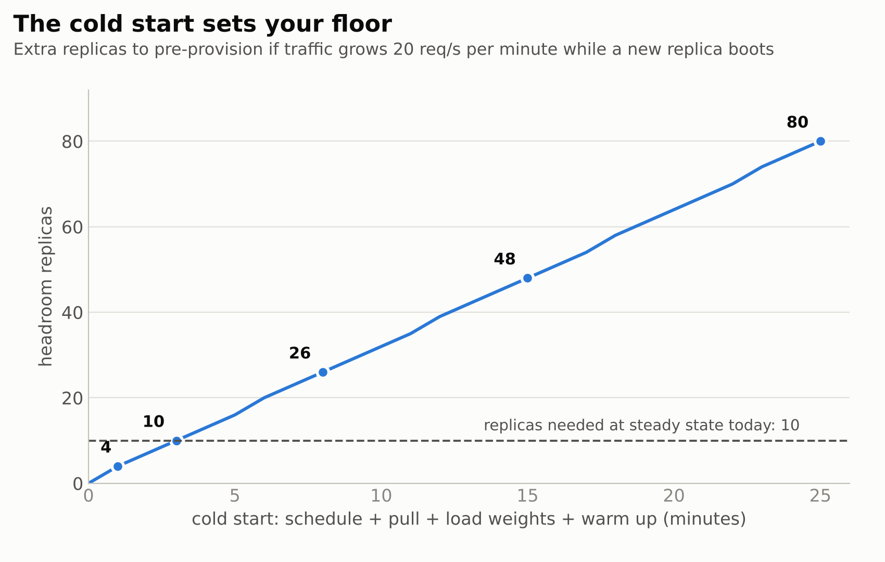

*Figure 5. Headroom grows roughly linearly with cold-start minutes. Shave minutes, save replicas.*

That table is why I stopped treating autoscaling as a capacity strategy. **Autoscaling is a smoothing strategy; the floor and the cold start are the capacity strategy.** The levers, in order of how much they move that table:

1. ⚡ **Shrink the cold start.** Pre-pull images onto GPU nodes, keep weights on node-local NVMe or an OCI volume, avoid downloading from the hub at boot. Every minute you cut is ~3 fewer headroom replicas *in this scenario*.
2. 🧱 **Keep a floor** based on your realistic ramp, not your average.
3. 🪑 **Placeholder pods** (below) to keep GPU nodes warm.
4. 🎚️ Only then, tune thresholds.

### The ScaledObject

```yaml
apiVersion: keda.sh/v1alpha1
kind: ScaledObject
metadata:
  name: vllm-llama
  namespace: inference
spec:
  scaleTargetRef: { name: vllm-llama }
  minReplicaCount: 2
  maxReplicaCount: 12
  pollingInterval: 15
  advanced:
    horizontalPodAutoscalerConfig:
      behavior:
        scaleUp:
          stabilizationWindowSeconds: 0
          policies: [{ type: Pods, value: 2, periodSeconds: 60 }]
        scaleDown:
          stabilizationWindowSeconds: 900
          policies: [{ type: Pods, value: 1, periodSeconds: 300 }]
  triggers:
  - type: prometheus
    metricType: AverageValue
    metadata:
      serverAddress: http://prometheus-operated.monitoring.svc:9090
      query: sum(vllm:num_requests_waiting{namespace="inference"})
      threshold: "3"        # per replica
  - type: prometheus
    metricType: AverageValue
    metadata:
      serverAddress: http://prometheus-operated.monitoring.svc:9090
      query: sum(vllm:gpu_cache_usage_perc{namespace="inference"})   # rename for your vLLM version
      threshold: "0.75"     # per replica
```

Two gotchas that cost people days:

- 🧮 **`AverageValue` already divides by replica count.** The HPA computes `query result ÷ current replicas`. If your query is already an `avg()`, you divide *twice* and under-scale as the fleet grows (fine at 2 replicas, stalls at 8). Return the **sum**; let the HPA divide.
- 🛑 **`cooldownPeriod` is not your scale-down brake.** In KEDA it only governs the wait before scaling to zero. Scale-down smoothing for the 1→N range lives in the HPA `behavior` block, which is why my long stabilisation window is there. Replicas are expensive to bring back, so I scale **up fast, down slow**.

And don't scale to zero unless your cold path is genuinely tolerable. With multi-minute starts, a floor of 2 is cheaper than the incident.

### 🪑 Placeholder pods to keep GPU nodes warm

```yaml
apiVersion: scheduling.k8s.io/v1
kind: PriorityClass
metadata:
  name: gpu-headroom
value: -10
description: "Placeholder capacity; preempted by real inference replicas"
---
apiVersion: apps/v1
kind: Deployment
metadata:
  name: gpu-headroom
  namespace: inference
spec:
  replicas: 1
  selector: { matchLabels: { app: gpu-headroom } }
  template:
    metadata: { labels: { app: gpu-headroom } }
    spec:
      priorityClassName: gpu-headroom
      terminationGracePeriodSeconds: 0
      resourceClaims:
      - name: gpu
        resourceClaimTemplateName: llm-gpu-70g
      containers:
      - name: pause
        image: registry.k8s.io/pause:3.10
        resources:
          claims:
          - name: gpu
```

A low-priority pod holds a GPU; when a real replica needs it, the scheduler preempts the placeholder. ⚠️ **I'd validate preemption of DRA-claimed pods on your exact Kubernetes version and driver before trusting this in prod**, and time the whole path (preempt → claim release → reschedule → warm). Don't assume.

---

## 🤖 Bonus: models operating the cluster (without giving them the keys)

Everything so far is models running *on* Kubernetes. The flip side is a model acting *on* Kubernetes: an agent reading events, logs and manifests and proposing fixes. The mistake I keep seeing is treating the agent's credentials as an afterthought. My rule: **write access is earned one verb at a time, and it starts at zero.**

```yaml
apiVersion: rbac.authorization.k8s.io/v1
kind: ClusterRole
metadata:
  name: ai-ops-readonly
rules:
- apiGroups: [""]
  resources: ["pods", "events", "nodes", "services", "namespaces"]
  verbs: ["get", "list", "watch"]
- apiGroups: [""]
  resources: ["pods/log"]
  verbs: ["get"]
- apiGroups: ["apps"]
  resources: ["deployments", "replicasets", "statefulsets"]
  verbs: ["get", "list", "watch"]
- apiGroups: ["resource.k8s.io"]
  resources: ["resourceclaims", "resourceslices", "deviceclasses"]
  verbs: ["get", "list", "watch"]
```

(ServiceAccount and binding are in `manifests/06-ai-ops-rbac.yaml`; all three validate against 1.34.)

Deliberate omissions: **no `secrets`**, no wildcard verbs, no write verbs. And two traps:

- 📜 **`pods/log` is an exfiltration path.** Logs routinely contain tokens, user content and PII, and whatever the agent can read it can repeat into a model context, a ticket or a chat thread. Scope per namespace where you can.
- 🧾 **Proposals should be diffs, not applies.** I have the agent emit a patch or `kubectl diff` output; a human (or a separate, narrowly-scoped pipeline with its own admission policy) applies it. The audit log then shows a human identity on every mutation and the agent's identity only on reads.

Verify the boundary instead of assuming it:

```bash
kubectl auth can-i --list --as=system:serviceaccount:ops-agents:ai-ops
kubectl auth can-i get secrets -A --as=system:serviceaccount:ops-agents:ai-ops
kubectl auth can-i delete pods -n inference --as=system:serviceaccount:ops-agents:ai-ops
```

---

## ✅ The pre-prod checklist I'd actually use

1. 🧮 **Capacity in tokens, not requests.** Know your per-replica KV budget and your *real* context-length distribution.
2. ⏱️ **Measure cold start end-to-end** on a *fresh* node (pod created → first successful request). It drives probe budgets, floor size and headroom.
3. 🔁 **Load-test with replayed traffic shape.** Fixed-length synthetic prompts hide exactly the head-of-line and prefix-cache effects you're paying the router to exploit.
4. 💀 **Kill the EPP under load** and confirm the gateway does what you *decided* it should do.
5. 🏷️ **Pin metric names per engine version.** A ScaledObject querying a renamed metric returns empty and fails *quietly*, which for an autoscaler means it silently stops scaling.
6. 🪑 **Exercise preemption and drain paths:** placeholder preemption and the `preStop` ordering.
7. 🔐 **Prove your agent's RBAC with `auth can-i`**, don't eyeball it.

---

## 🏁 The through-line

Kubernetes is a fantastic control plane for workloads that tell it the truth. Inference workloads are expensive, stateful in ways the scheduler can't see, and slow to start. Every layer above is about getting the truth *into the API*:

- 🎛️ **device shape** → claims and CEL selectors
- 🧮 **capacity** → KV tokens, not request counts
- 🧭 **locality and load** → the endpoint picker's score
- ⏳ **time** → a cold start you plan around instead of hoping away

Do that, and the generic machinery goes back to being good at its job. 🚀

---

### 🧰 Run it yourself

Everything in this post (the calculators, the routing simulator, the manifests, the tests and the screenshot pipeline) lives in one repo:

👉 **[github.com/Bilalkhanten/llm-inference-on-kubernetes](https://github.com/Bilalkhanten/llm-inference-on-kubernetes)**

```bash
git clone https://github.com/Bilalkhanten/llm-inference-on-kubernetes.git && cd llm-inference-on-kubernetes
make install
make all        # kvcalc, capacity planner, routing sim, offline schema validation
make test       # 13 tests, no GPU or cluster needed
```

Lint and the test suite pass locally and on every push (CI runs the same targets):

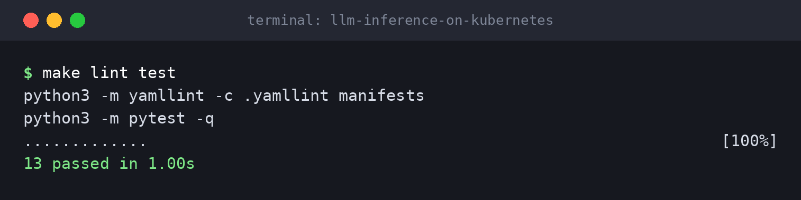

Swap in your own model dimensions, latencies and traffic. The *shape* of the answers is what matters; the specific numbers are mine.

**Sources:**
- [Introduction to Dynamic Resource Allocation (DRA) in Kubernetes: Rafay](https://rafay.co/ai-and-cloud-native-blog/introduction-to-dynamic-resource-allocation-dra-in-kubernetes)
- [About dynamic resource allocation: GKE docs](https://docs.cloud.google.com/kubernetes-engine/docs/concepts/about-dynamic-resource-allocation)
- [Introducing Gateway API Inference Extension: kubernetes.io](https://kubernetes.io/blog/2025/06/05/introducing-gateway-api-inference-extension/)
- [Gateway API Inference Extension: NVIDIA Dynamo docs](https://docs.nvidia.com/dynamo/dev/kubernetes-deployment/request-routing/gateway-api-inference-extension/overview.md)
- [Autoscaling with KEDA: vLLM production-stack docs](https://docs.vllm.ai/projects/production-stack/en/latest/use_cases/autoscaling-keda.html)
